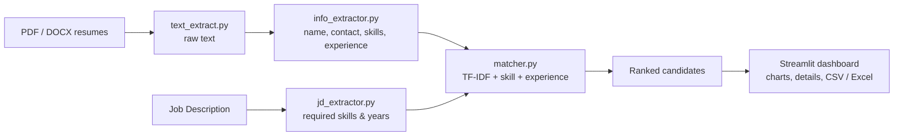

<div align="center">

# 🧑‍💼 Smart Resume Screening & Candidate Ranking Tool

**Paste a job description, drop in a pile of resumes, and get a ranked shortlist in seconds.**

[](https://github.com/nikhil-2301-dot/smart-resume-screener/actions/workflows/ci.yml)


[**Live demo**](https://smart-resume-screener-vrd2jrwut7pqsybvhgwsnc.streamlit.app/) · [Report a bug](../../issues) · [Request a feature](../../issues)

</div>

---

## What it does

Reading 100 resumes by hand is slow and inconsistent. This tool does the first pass for you:

1. Upload multiple **PDF / DOCX** resumes.
2. Paste the **Job Description** (JD).
3. It extracts each candidate's name, contact info, skills, education and years of experience.
4. It scores every candidate against the JD and **ranks them**, with a clear breakdown of *why*.
5. Export the results to **CSV or Excel**.

> No black box. Every score is built from three simple parts you can read, explain and tweak.

## Try it in 30 seconds

Open the app, tick **"Use sample data (demo)"** in the sidebar, and press **Run Screening & Rank Candidates**.
It loads a sample JD and three sample resumes from [`sample_data/`](sample_data).

## Features

- 📄 Multi-file upload for PDF and DOCX (tables inside DOCX are read too)
- 🔎 Rule-based extraction of name, email, phone, skills, education and experience
- 🎯 Required skills and experience pulled automatically from the JD
- 📊 Interactive ranking table plus Plotly charts for the score and its breakdown
- ✅ Per-candidate view of **matched** and **missing** skills
- ⬇️ One-click CSV and Excel export
- 🧪 Unit-tested core logic with GitHub Actions CI

## How the score works

```
Final Score = 50% × JD Similarity  +  30% × Skill Match  +  20% × Experience Match
```

| Part | How it is calculated |
|---|---|
| **JD Similarity (50%)** | TF-IDF vectors of the JD and each resume, compared with cosine similarity. |
| **Skill Match (30%)** | Share of the JD's required skills (from [`skills_vocabulary.py`](utils/skills_vocabulary.py)) found in the resume. |
| **Experience Match (20%)** | 100% if the candidate meets the required years, otherwise proportional (3 yrs vs 5 required = 60%). |

If the JD names no skills or no experience, that part is treated as neutral (100%) so nobody is penalised for it.

### Pipeline



## Project structure

```
smart-resume-screener/
├── app.py                    # Streamlit dashboard (entry point)
├── utils/
│   ├── text_extract.py       # PDF / DOCX → raw text
│   ├── info_extractor.py     # name, email, phone, skills, education, experience
│   ├── jd_extractor.py       # required skills & years from the JD
│   ├── matcher.py            # TF-IDF similarity, skill/experience match, final score
│   └── skills_vocabulary.py  # editable list of skills to look for
├── tests/                    # pytest suite
├── sample_data/              # demo JD + 3 sample resumes
├── .github/workflows/ci.yml  # lint + tests on every push
├── requirements.txt
└── requirements-dev.txt
```

## Run it locally

```bash
git clone https://github.com/nikhil-2301-dot/smart-resume-screener.git
cd smart-resume-screener

python -m venv .venv
source .venv/bin/activate        # Windows: .venv\Scripts\activate

pip install -r requirements.txt
streamlit run app.py
```

Then open <http://localhost:8501>.

## Deploy it for free

1. Push this repo to GitHub (public).
2. Go to [share.streamlit.io](https://share.streamlit.io), sign in with GitHub and click **Create app**.
3. Pick this repo, branch `main`, main file `app.py`, then **Deploy**.
4. Put your new app link at the top of this README.

## Customise it

- **Add skills:** edit the list in [`utils/skills_vocabulary.py`](utils/skills_vocabulary.py). Marketing, finance, design, anything.
- **Change the weights:** edit the three `WEIGHT_*` constants at the top of [`utils/matcher.py`](utils/matcher.py).

## Run the tests

```bash
pip install -r requirements-dev.txt
pytest
ruff check .
```

## Known limitations

- Extraction is rule-based on purpose (simple and explainable), so unusual resume layouts can confuse name or experience detection.
- Scanned PDFs (images with no text layer) are not supported, there is no OCR.
- Skill matching is keyword-based, so it will not understand synonyms that are not in the vocabulary.
- Treat the ranking as a **screening aid, not a hiring decision**. Always have a human review the shortlist, and never rely on it alone.

## Roadmap

- [ ] SQLite storage for past screening runs
- [ ] Semantic matching with `sentence-transformers` blended into the score
- [ ] OCR for scanned resumes
- [ ] Editable score weights in the sidebar
- [ ] spaCy-based name and entity extraction

## Contributing

Pull requests are welcome. See [CONTRIBUTING.md](CONTRIBUTING.md).

## License

MIT, see [LICENSE](LICENSE).
